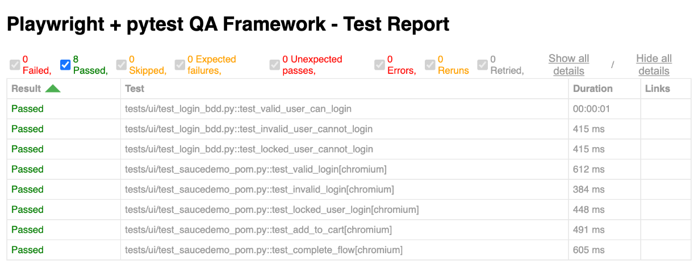

# Playwright + pytest QA Automation Framework

[](https://github.com/NimeshaDev/playwright-pytest-qa-framework/actions/workflows/tests.yml)

📊 **[Live test reports](https://nimeshadev.github.io/playwright-pytest-qa-framework/)** - updated after every CI run

UI, API and BDD test automation in Python, built with Playwright and pytest, using the Page Object Model. Every push runs the UI tests on Chromium, Firefox and WebKit in GitHub Actions and publishes an HTML test report.

**At a glance:** 13 automated tests (8 UI including 3 BDD scenarios, 5 API) · 29 test executions per run across 3 browsers · positive and negative cases · JSON schema validation · screenshots and traces on failure

## Test strategy

I approached this the way I would a real product: start from the risks, then decide what to automate and at which level.

| Risk | Why it matters | How it is covered |
|------|----------------|-------------------|
| Users cannot log in, or the wrong users can | Login is the entry point to everything; a locked-out account getting in is a security issue | Valid, invalid and locked-out logins, in a parametrised UI test and as BDD scenarios |
| Core purchase journey breaks | Add-to-cart is the main business flow of the shop | Add-to-cart test and a full login-to-cart flow test |
| Behaviour differs between browsers | Customers use Chrome, Firefox and Safari | Every UI test runs on Chromium, Firefox and WebKit in CI |
| API returns wrong data or wrong structure | Front ends and integrations break silently when a contract changes | Status-code checks (200, 201, 404), field checks and JSON schema validation |
| API mishandles requests for missing data | Unhandled errors cause crashes downstream | Negative test: unknown user returns 404 |

**Test levels:** API tests run first and fast, without a browser; UI tests cover the user journeys that matter most; BDD scenarios describe login in business language that a product owner can read.

## Test coverage

| Test | Type | Case | Smoke |
|------|------|------|:-----:|
| Login with valid user | UI (POM) | Positive | ✔ |
| Login with invalid user | UI (POM) | Negative | ✔ |
| Login with locked-out user | UI (POM) | Negative | ✔ |
| Add first product to cart | UI (POM) | Positive | |
| Full flow: login, add to cart, verify cart | UI (POM) | Positive | ✔ |
| Valid user can login | BDD | Positive | |
| Invalid user cannot login | BDD | Negative | |
| Locked user cannot login | BDD | Negative | |
| GET single user returns 200 and correct data | API | Positive | ✔ |
| User response matches JSON schema | API | Positive | |
| GET unknown user returns 404 | API | Negative | |
| POST create user returns 201 with the sent data | API | Positive | |
| GET all users returns 10 users, each matching the schema | API | Positive | |

## Design decisions

- **Page Object Model** - locators and page actions live in `pages/`, so tests read like user steps and a UI change is fixed in one place, not in every test.
- **Data-driven tests** - test users live in `data/test_data.json` and login cases are parametrised, so a new case is one line of data rather than a new test.
- **Shared fixtures in `conftest.py`** - test data and the API session are created once per run (the API session is opened and closed with `yield`), keeping tests short and independent.
- **Markers (`ui`, `api`, `smoke`)** - a quick smoke run can gate a release before the full suite.
- **User-facing locators** - login uses `get_by_placeholder` and `get_by_role`, which are closer to how a user finds elements and less brittle than long CSS paths.
- **Fail with evidence** - on failure the HTML report embeds a full-page screenshot and CI keeps a Playwright trace, so a failure can be investigated without re-running it.

## Tech stack

| Tool | Purpose |
|------|---------|
| Python 3.11 | Language |
| Playwright | Browser automation |
| pytest | Test runner and fixtures |
| pytest-bdd | Gherkin / BDD scenarios |
| pytest-playwright | Browser fixtures, cross-browser runs, failure screenshots and traces |
| pytest-html | HTML test reports |
| requests | API testing |
| jsonschema | API response schema validation |
| Postman | Manual API exploration |
| GitHub Actions | CI pipeline |

## Project structure

```
.
├── .github/workflows/tests.yml   CI pipeline
├── conftest.py                   Shared fixtures (browser page, test data, API session)
├── pytest.ini                    pytest and pytest-bdd settings
├── requirements.txt
├── data/test_data.json           Test users and URLs
├── features/login.feature        Gherkin scenarios
├── pages/                        Page Object Model classes
│   ├── login_page.py
│   ├── inventory_page.py
│   └── cart_page.py
├── postman/                      Postman collection
└── tests/
    ├── api/test_users_api.py     REST API tests
    └── ui/
        ├── test_saucedemo_pom.py UI tests (POM)
        └── test_login_bdd.py     BDD step definitions
```

## How to run

```bash
pip install -r requirements.txt
playwright install chromium
pytest                 # all tests
pytest tests/api       # API only
pytest tests/ui        # UI and BDD only
pytest -m smoke        # critical-path smoke tests (markers: ui, api, smoke)
pytest tests/ui --browser firefox --headed   # watch it run in Firefox
pytest --html=reports/report.html --self-contained-html   # HTML report
```

## CI and test reports

GitHub Actions runs on every push and pull request:

- **API tests** once
- **UI and BDD tests** on Chromium, Firefox and WebKit in parallel
- On failure: a screenshot is embedded in the HTML report, and a Playwright trace is saved

**[View the latest test reports](https://nimeshadev.github.io/playwright-pytest-qa-framework/)** - published to GitHub Pages after every run on `master`.



## Known limitations and next steps

Being honest about gaps is part of testing. What I would improve next:

- **Assert error messages** - the negative login tests check that the user stays on the login page; they should also check the error text shown (e.g. the locked-out message).
- **Checkout coverage** - extend the journey through checkout, including form validation (missing first name, postcode).
- **API negative cases** - invalid payloads and missing fields on POST.
- **Test data independence** - the API tests use a public demo API whose data could change; a real project would use a controlled test environment or mocks.
- **Next project** - applying the same approach to a payroll domain, where I have three years of commercial testing experience.

## About

Built by Nimesha Herath - QA Engineer with 4+ years of experience, MSc in Information Systems and Computing (First Class Honours), ISTQB Foundation certified.

[LinkedIn](https://www.linkedin.com/in/nimeshadev) · [Portfolio](https://nimeshadev.github.io)
